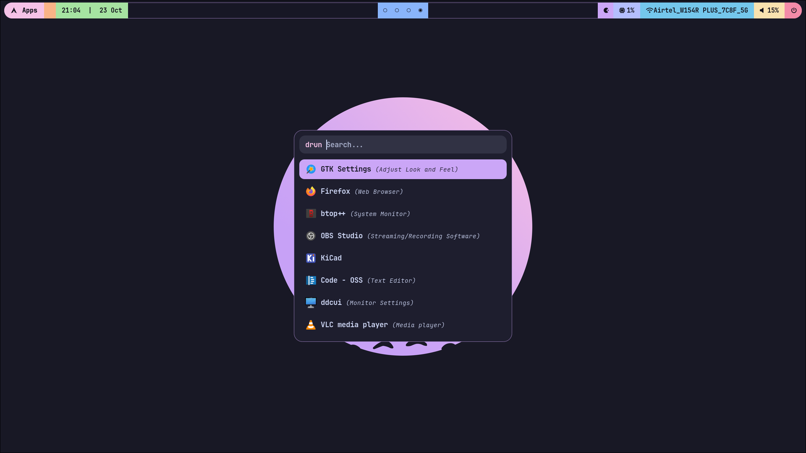

# CachyOS Mocha

My CachyOS desktop built around Hyprland and Catppuccin Mocha: a pastel Waybar, rounded Rofi launcher, styled Kitty terminal, and matching lock screen.



Captured on October 23, 2026, running Hyprland 0.56.2. Requires **Hyprland 0.55+ with Lua configuration**, an existing CachyOS installation, and working graphics drivers.

## Install

Run as your normal desktop user with sudo access:

```bash
sudo pacman -Syu --needed git python
git clone https://github.com/norbertsawe/cachyos-mocha.git ~/Projects/cachyos-mocha
cd ~/Projects/cachyos-mocha
./install.sh --yes
```

The installer installs [`packages.txt`](packages.txt), backs up existing settings, copies configurations and bundled appearance assets, registers the **CachyOS Mocha** login session, and configures network, Bluetooth, and audio services. Your login shell stays unchanged; Kitty starts Zsh with the captured Powerlevel10k prompt.

Choose **CachyOS Mocha** in Ly on tty2 (`Ctrl+Alt+F2`). Installation enables and starts `ly@tty2`, which may switch the active virtual terminal. It disables the previous graphical login manager for future boots without stopping its running session, and frees tty2 by stopping its getty. Existing network services and explicitly masked services are respected.

## Configurations only

With the repository cloned and Python 3 installed:

```bash
./install.sh --config-only
```

This copies configurations, helpers, themes, cursors, and wallpaper without installing packages, using sudo, changing services, or registering a login session. Existing settings are backed up. Log out and return to your existing Hyprland session afterward.

| Option | Effect |
| --- | --- |
| `--dry-run` | Preview destinations without changes |
| `--config-only` / `--configs-only` | Copy configurations and assets only |
| `--minimal` | Omit editor and alternate-terminal configurations; package bundle stays complete |
| `--no-services` | Leave service states unchanged |
| `--no-session` | Skip branded session registration and Ly activation |
| `--yes` | Accept package prompts; sudo may still ask for a password |

Options can be combined. Clone outside the configuration directories being replaced. Files are copied independently, so the clone can be moved afterward.

## Included settings

- Hyprland window rules, animations, workspaces, media keys, screenshots, clipboard history, and wallpaper selection.
- Waybar, Rofi, Kitty, Hyprlock, notifications, and a desktop settings launcher.
- GTK/Kvantum themes, Papirus icons, Bibata cursors, and utility/editor configurations.
- Zsh and Powerlevel10k, plus preferences for Alacritty, Ghostty, Fuzzel, btop, Cava, Micro, Neovim, and htop.

Mocha is the main desktop palette. The captured workstation also uses a Noctalia palette in Alacritty, Tokyo Night in btop, Macchiato in Micro, and generated GTK3 accent colors. Neovim downloads plugins on first launch. Spotify opens in the browser; no AUR helper is required.

See [capture notes](CAPTURE_NOTES.md) for portability adjustments and differences from the workstation. Personal profiles, credentials, clipboard contents, and shell history are excluded.

## Shortcuts

| Keys | Action |
| --- | --- |
| `Super+Return` | Kitty / Zsh |
| `Super+Space` / `Super+Shift+Space` | Applications / run command |
| `Super+,` | Desktop settings |
| `Super+E` / `Super+B` / `Super+Shift+B` | Nemo / Firefox / Chromium |
| `Super+C` / `Super+Shift+Return` | Calculator |
| `Super+M` | Spotify Web |
| `Super+Shift+E` / `Super+Shift+C` | Emoji / clipboard history |
| `Super+Shift+W` | Wallpaper picker |
| `Super+W` | Lock screen |
| `Super+P` / `Super+Shift+P` | Window / frozen region screenshot |
| `Super+Escape` | Session and power menu |
| `Super+Q` | Close window |
| `Super+F` / `Super+Shift+F` | Maximize / toggle floating |
| `Super+H/J/K/L` | Focus left/down/up/right |
| `Super+Shift+H/J/K/L` | Move window |
| `Super+1…0` / `Super+Shift+1…0` | Switch workspace / move window to workspace |

Waybar's Apps button opens Rofi; right-click opens desktop settings. The power button opens a confirmation menu. Workspace 2 uses scrolling; the others use dwindle.

## Customize

Edit installed settings under `~/.config`. Managed directories are replaced during reinstall, except `hypr/local.lua`, which is preserved for machine-specific settings:

```lua
hl.monitor({ output = "DP-1", mode = "1920x1080@60", position = "0x0", scale = "1" })
```

Defaults detect monitors automatically. Hardware modules may be unavailable on some machines. Add wallpaper images to `~/Pictures` or `~/.local/share/cachyos-mocha/wallpapers`, then open the wallpaper picker.

```bash
~/.local/bin/mocha-wallpaper /absolute/path/to/image.png
~/.local/bin/mocha-doctor
```

The installer respects `XDG_CONFIG_HOME`, `XDG_DATA_HOME`, and `XDG_STATE_HOME`. Helpers are installed to `~/.local/bin`; the login wrapper goes to `/usr/local/bin`. GTK4 applications that enforce their own appearance may differ.

## Restore

Every install prints its backup location and restore command:

```bash
./install.sh --restore ~/.local/state/cachyos-mocha/backups/<timestamp>
```

Restore saves displaced files, restores original files and symlinks, removes newly introduced destinations, and reverses service changes recorded by that install. System files and services require sudo. Packages remain installed. Restore multiple installs in reverse order; each backup can be restored once. Log out and back in afterward.

## Validation

```bash
python3 -m unittest discover -s tests -v
bash -n install.sh bin/* session/cachyos-mocha-session
Hyprland --verify-config -c "$PWD/config/hypr/hyprland.lua"
```

Installer tests cover isolated homes, custom XDG paths, replacement, restore, preserved overrides, rollback, minimal mode, and mocked services. Hyprland parsing was checked on 0.56.2. A fresh OS installation and the updated visuals in a separate desktop session have not been tested end to end.

Personal setup by [norbertsawe](https://github.com/norbertsawe), unaffiliated with CachyOS, Hyprland, or Catppuccin. See [third-party credits and licenses](THIRD_PARTY.md).
